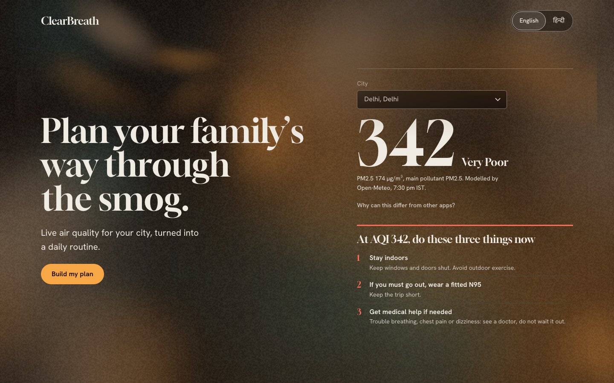
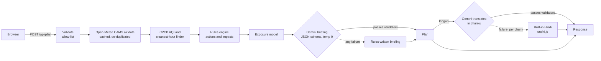
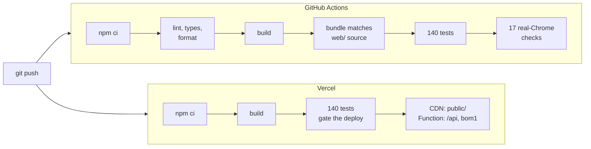

<div align="center">

# ClearBreath

**A GenAI assistant that turns today's live air quality into a plan a family can follow.**
Winter smog guidance for Indian cities, in English and Hindi, with the impact of every choice explained.

[](https://github.com/sahil-mangla/ClearBreath/actions/workflows/ci.yml)
[](https://vercel.com/new/clone?repository-url=https://github.com/sahil-mangla/ClearBreath)




<sub>The home screen on a real reading: the smoke density follows the live AQI, and the "do these now" strip works before any form is filled in.</sub>

</div>

**Prompt Wars, Challenge 6: GenAI Urban Air Quality Assistant.** Quick links: [Judging map](#judging-map) · [Run it](#run-it-in-two-minutes) · [How it works](#how-it-works) · [CI/CD](#cicd-and-deployment) · [Design decisions](#design-decisions-and-trade-offs)

## The problem

Every winter, Delhi-NCR and the Indo-Gangetic plain spend weeks in the CPCB "Very Poor" to "Severe" bands. Generic advice ("avoid going out") does not help a parent deciding on the school run, a family that cooks on biomass, or a household with an asthmatic grandparent. ClearBreath ties advice to three things: today's air, who is in the house, and how they live.

## What a user gets

| The brief asks for | ClearBreath delivers |
|---|---|
| **Low-emission daily routine** | The cleanest outdoor hour from the forecast, mask guidance by risk, commute tips by mode (for example "wear an N95 in an auto-rickshaw; keep windows up in a cab"), GRAP awareness |
| **Indoor air quality hacks** | Sealing, purifier or Corsi-Rosenthal box, cooking and heating safety (with a carbon-monoxide warning for indoor coal or wood), a clean room for vulnerable members |
| **Sustainable alternatives** | Commute swaps with CO2 per km, clean cooking (LPG, PNG, induction, PM Ujjwala), no-burn warmth, community and RWA action |
| **Tailored to location and lifestyle** | 22 Indian cities; household (children, seniors, asthma, heart condition, pregnancy); commute mode and distance; cooking fuel; heating; purifier and N95 on hand |
| **Explain the direct impact of choices** | An impact line on every action, plus a before/after exposure estimate whose assumptions are listed next to it, and a switch that thins the on-screen haze to show the plan's effect |

Also: a Gemini-written briefing and an "Ask ClearBreath" box; a whole-page Hindi interface; a print and copy view for sharing with neighbours, an RWA or a school; and a low-power mode for weak devices.

## Judging map

Each criterion below names the evidence to check, so every claim can be verified in the repo.

| Criterion | What to look at | Evidence |
|---|---|---|
| **Problem-statement alignment** | `src/rules.js`, `src/aqi.js`, `src/cities.js` | All three asks answered; India-specific content (CPCB bands, GRAP, PM Ujjwala, RWA, auto-rickshaw exposure); advice changes with the inputs; clean days do not promise reductions that do not exist |
| **Code quality** | `src/` (backend), `web/` (front end), `src/determinism.js` | Small single-purpose modules; pure functions for rules, AQI maths, validators and the Hindi catalogue; one definition of shared facts; zero runtime dependencies |
| **Security** | `src/validate.js`, `src/app.js`, `src/llm.js`, `src/ratelimit.js` | Fixed city allow-list (no SSRF), strict validation, 8 KB body cap, strict CSP, server-only key, prompt-injection containment, per-IP and global limits |
| **Efficiency** | `src/airdata.js`, `src/llm.js`, `src/app.js` | One upstream call per city per 10 minutes, hash-keyed Gemini caches, gzip and ETag, off-screen canvases pause, parallel translation |
| **Testing** | `test/`, `scripts/browser-smoke.mjs`, `.github/workflows/ci.yml` | 140 backend, front-end and deploy tests, 17 real-Chrome checks, all run in CI and again before every deploy |
| **Accessibility** | `web/PlanForm.jsx`, `web/SmogText.jsx`, `test/components.test.js` | Labels and fieldsets, `aria-invalid` with inline messages, focus management, pausable motion, measured contrast, `lang` handling |

To verify everything yourself:

```bash
npm ci && npm test && npm run test:browser
```

## Run it in two minutes

Requires Node 22 or later. The server has no runtime dependencies and the built front end is committed, so nothing needs installing to run it.

```bash
cp .env.example .env     # optional: add GEMINI_API_KEY; without it the rules engine writes everything
npm start                # http://127.0.0.1:3000
```

```bash
npm ci                   # development only (React, esbuild, fonts)
npm test                 # 140 tests: backend, front-end components, deploy config. No network.
npm run test:browser     # 17 checks in real headless Chrome (skips if Chrome is absent)
npm run build            # rebuild public/app.js after editing web/
```

| Variable | Default | Purpose |
|---|---|---|
| `GEMINI_API_KEY` | none | Enables the Gemini briefing, Hindi translation and Q&A |
| `GEMINI_MODEL` | `gemini-3.5-flash-lite` | Model name |
| `GEMINI_MAX_CALLS_PER_MIN` | `120` | Global ceiling on Gemini calls per minute (retries count) |
| `PORT` / `HOST` | `3000` / `127.0.0.1` | Listen address |
| `RATE_LIMIT_PER_MIN` | `20` | Per-IP API requests per minute |
| `TRUST_PROXY` | unset | Set to `1` behind a reverse proxy to read `X-Forwarded-For` (always on under Vercel) |

## How it works

The rules engine is the product; Gemini is an enhancement. Every number comes from deterministic code. Gemini phrases, explains and translates, and nothing it writes reaches the page until it passes validation.



| Path | Role |
|---|---|
| `server.js` | Local entry point: loads `.env`, starts the server |
| `api/index.js` | Vercel entry point: the same handler, API only |
| `vercel.json` | Vercel build, routing and header configuration |
| `src/app.js` | Routing, security headers, rate limiting, static serving (ETag, gzip) |
| `src/validate.js` | Allow-list validation and sanitisation of every input |
| `src/cities.js` | The fixed list of 22 supported cities |
| `src/airdata.js` | Open-Meteo client: timeout, 10-minute cache, in-flight de-duplication, stale-while-error, cleanest-hour finder |
| `src/aqi.js` | India CPCB AQI sub-index and bands from PM2.5 and PM10 |
| `src/rules.js` | Recommendation engine, impact constants, exposure model |
| `src/llm.js` | Gemini client: schema-constrained output, temperature 0, fixed seed, hash-keyed caches, call budget |
| `src/determinism.js` | Number-grounding and translation validators |
| `src/hi.js`, `src/translate.js` | Built-in Hindi catalogue; chunked Gemini translation with per-chunk fallback |
| `web/` | React front end source: form, results, readout, ask panel, smoke and skyline canvases |
| `public/` | Built bundle, stylesheets, self-hosted fonts, HTML shell |
| `scripts/` | esbuild build script and the real-Chrome smoke test |
| `test/` | Unit, component and integration tests |

The backend is `server.js` and `src/`; the front end is `web/` built into `public/`. The front end imports two backend modules, `src/aqi.js` for the CPCB bands and `src/constants.js` for the language list, so both sides share one definition.

## CI/CD and deployment



- **CI** (`.github/workflows/ci.yml`) runs on every push and pull request. It lints (oxlint, warnings fail), type-checks the server (`tsc` over JSDoc types), checks formatting (Prettier), builds, fails if the committed bundle differs from a fresh build of `web/`, then runs the unit suite and the real-browser smoke test.
- **CD** is Vercel's Git integration. The build command in `vercel.json` is `npm run build && npm test`, so a deploy that fails a test does not go live.
- **Hosting.** `public/` is served from the CDN with the same security headers as the Node server (a test enforces that they match). `api/index.js` serves `/api/*` and `/healthz` in the Mumbai region (`bom1`) with a 30-second limit; behind Vercel the rate limiter keys on `X-Forwarded-For`.
- **Configuration.** Set `GEMINI_API_KEY` (and optionally the variables above) in the Vercel project settings. Without a key the app serves the rules-engine answers.
- **Deploy yourself:** use the Vercel badge above, or `npm i -g vercel && vercel`.

## Engineering detail

### Problem-statement alignment

All three asks are answered with India-specific content: CPCB AQI bands, GRAP in Delhi-NCR, stubble-burning season, PM Ujjwala, RWA action, and mask and commute guidance for Indian transport, including open auto-rickshaws. The plan responds to its inputs: a child or senior raises the protection level, a heart or asthma condition adds its own advice (with "follow your own doctor's advice first"), and a clean day is not told it will gain exposure reductions it cannot. Impact is explained per action and for the plan as a whole.

### Code quality

Details and the checks that enforce them are in [CODE_QUALITY.md](CODE_QUALITY.md).

- One job per module. The server is `http.js` (headers, errors, body parsing), `static.js` (assets, caching), `handlers.js` (the three endpoints) and `app.js` (routing only). The rules engine is one small file per concern under `src/rules/` (routine, indoor, alternatives, alerts, exposure, briefing), each action a short function.
- Pure functions for the rules, the AQI maths, the validators and the Hindi catalogue, so the logic is testable without a server or a network.
- Enforced in CI: `oxlint --deny-warnings`, `tsc` over the server's JSDoc types, Prettier, then the tests. `npm run check` runs all of them locally.
- One definition of shared facts (AQI bands, language list, mask rule) rather than a copy on each side.
- Zero runtime dependencies on the server. The front end is bundled once and committed.
- English and Hindi plan text are kept in step by a test that checks identical keys and placeholders.
- Errors carry a stable `code`, which the interface maps to a message in the chosen language.

### Security

| Threat | Control |
|---|---|
| SSRF, injection through location | No free-text location: cities come from a fixed allow-list, looked up with `Object.hasOwn` so `__proto__` cannot select an entry |
| Malformed or hostile input | Types, ranges and enums checked; unknown keys ignored; 8 KB body cap (413); wrong type 415; wrong method 405 |
| XSS and content injection | CSP `default-src 'none'` with no inline script or style; `nosniff`, no-referrer and a permissions policy; server and model text rendered only as React text nodes; fonts self-hosted so the policy stays `font-src 'self'` |
| Secret leakage | The Gemini key stays on the server, travels in a header, and is never placed in a URL or log line; `.env` is git-ignored |
| Prompt injection | User text goes only into a JSON `untrusted` field, the system prompt says to treat it as data, output is schema-constrained, ids and lengths are clamped, and answers containing links or markup are rejected |
| Abuse and cost | Per-IP rate limiter (IPv6 keyed by /64, bounded memory) and a global Gemini call ceiling |
| Information disclosure | Generic errors; no stack traces or upstream details leave the server |

### Efficiency

- One upstream air call per city per 10 minutes however many users ask, with in-flight de-duplication and a one-hour stale reading if Open-Meteo fails.
- Gemini responses are cached by a hash of the request (separate caches for briefings, answers and translations), with a small token budget and one retry on 429 or 503 that shares a single deadline.
- Static files are pre-gzipped at start-up and served with ETag and 304, long-lived caching for fonts, and revalidation for the bundle.
- The smoke and skyline canvases pause when off-screen or when the user presses Pause, and low-power devices get a lighter scene.
- Translation runs in parallel chunks, so one slow call delays only its own part.

### Testing

140 tests with `node --test`, no network required, covering three layers:

- **Backend.** CPCB breakpoints and band edges; validation and injection strings; prototype-key and oversize inputs; the rules engine per scenario; the exposure model (clean days, open versus closed cabins); the air client (cache, de-duplication, timeouts, stale-while-error); the Gemini client (key placement, retry, budget, id filtering, clamping, rejection of ungrounded figures and links); determinism (identical requests give identical output, the Hindi catalogue is exhaustive over every action, translation validators reject wrong counts, missing Devanagari, markup and changed figures); and HTTP integration (security headers, path traversal, fonts, `/api/air`, and the 400, 405, 413, 415, 429, 502 and 503 paths, with and without Gemini).
- **Front end.** The real React components are bundled with esbuild and rendered to HTML inside the test run, with no browser and no extra dependency. Tests check that every control has a bound label, fieldsets have legends, server field errors set `aria-invalid` with an inline message and a focusable summary, Hindi renders the same controls, the busy button stays focusable, and the animated headline is read once as plain text. Pure helpers (haze density, text timing, skyline, share text, low-power detection) and the English/Hindi string tables are tested too.
- **Deployment.** `vercel.json` is checked (output folder, rewrites, build command, immutable font caching), the CDN's security headers must equal the server's, and the Vercel function is driven over a real socket (health, cities, 404, 405, 415, and rate limiting keyed on `X-Forwarded-For`).

`npm run test:browser` adds 17 checks in real headless Chrome with a mocked air reading: canvases mount and move, no CSP violation fires, the severe-air strip, themed dropdowns, the Hindi toggle with no stray English, the haze switch visibly changing the smoke, the print layout, low-power and reduced-motion modes, and no sideways scroll at phone width.

### Accessibility

- Skip link, landmarks, labelled fields in fieldsets, help text tied by `aria-describedby`.
- After a failed submit, focus moves to an error summary and the offending fields are marked `aria-invalid` with an inline message. After a new plan, focus moves to the results heading, but not when only the language changes.
- A polite status line announces progress; critical alerts use `role="alert"`.
- AQI is conveyed by number and word as well as colour. Body text measured over the animated smoke is at least 5:1 against the pixels behind it, and the palette is designed for AA contrast in light, dark and print.
- All motion respects `prefers-reduced-motion`, looping motion can be paused (WCAG 2.2.2), and the animated headline is exposed to screen readers as plain text.
- Correct `lang` on the document and on mixed-language text, 44 px touch targets, visible focus, a responsive layout, and a flow that works by keyboard alone.

## Responsible AI and determinism

- Every Gemini call runs at `temperature: 0` with a fixed seed, and results are cached by a hash of the request, so identical requests give identical text.
- A briefing or answer may not quote a figure above 10 that is absent from the facts supplied to the model. A translation must keep the same count, contain Devanagari, carry no markup, and keep every figure unchanged.
- On any failure (no key, timeout, rate limit, validation, exhausted budget) the app falls back to built-in text. The built-in Hindi is a pure function of the action id and its parameters.
- The response reports whether the Hindi came from `gemini`, `builtin` or `mixed`, and the page says so.
- The assistant is told it is not a doctor, and households with vulnerable members are told when to seek care.

## Design decisions and trade-offs

| Decision | Why |
|---|---|
| Rules engine first, LLM second | Health advice should not depend on a model's mood. Gemini adds tone and translation, and the app is complete without it. |
| Fixed city list instead of geocoding | Bounds outbound requests and removes the SSRF surface, at the cost of coverage (22 cities). |
| Modelled air data (CAMS via Open-Meteo) | Free, keyless and available for every listed city. The UI says it can differ from CPCB station readings and why. |
| Zero runtime dependencies | Smaller attack surface, faster cold starts, nothing to patch. React and esbuild are build-time only. |
| Built-in Hindi catalogue as the fallback | Keeps the Hindi page deterministic and available when Gemini is busy, instead of silently showing English. |
| Vercel CDN for static files, one function for the API | Static assets are fast and free to serve; only the API needs compute, and it runs close to users in Mumbai. |

## Data and assumptions

- **Air data** is the CAMS model estimate from Open-Meteo, not CPCB station readings, and the CPCB bands are applied to current rather than 24-hour averages. The interface explains why it can differ from other apps.
- **Impact figures** (mask efficiency, purifier reduction, CO2 per km) are typical-value approximations, labelled as such, and the exposure model's assumptions are shown beside its result.
- **Scaling.** The rate limiter and caches live in each process or function instance. Behind several instances, put a shared limiter in front and set a spend quota on the Gemini project.
- **Not medical advice.**
